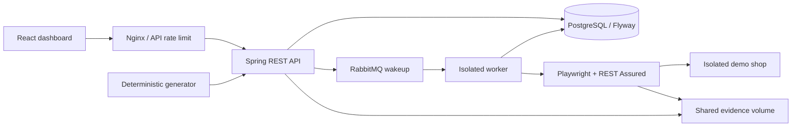

# Architecture

The API and worker share the persistence module, but run as separate processes. The engine and AI libraries have no dependency on API controllers. The demo is independent of production services.

Execution lifecycle: validated request → persisted QUEUED row → optional broker notification → atomic QUEUED-to-RUNNING compare-and-set → fresh fixture → browser actions and controlled faults → independent API state read → invariant evaluation → terminal status and finding rows. Jobs cannot be claimed twice. Jobs left RUNNING beyond 180 seconds are marked INCONCLUSIVE rather than automatically replaying state-changing requests.

Discovery uses a bounded breadth-first queue and same-origin routing. Element metadata includes role, name, locator candidates, supported interactions, confidence, and checkout workflow association. Current workflow classification is demo-specific. Imported OpenAPI documents are parsed as data; referenced servers and external refs are not fetched.

SSE uses one bounded shared scheduler and at most 20 subscribers. Workers use bounded concurrency pools and close Playwright contexts/browsers with try-with-resources. Cancellation is cooperative at action boundaries and API calls; socket/browser timeouts bound individual waits. Database polling ensures jobs persist through broker outages. Terminal execution state and finding rows are committed in one transaction.

Schema stores immutable plans/results as JSON text and first-class rows for projects, targets, scenarios, executions, discoveries, findings, reports, and audits. The larger normalized master-spec model is intentionally not represented as empty placeholder tables.

